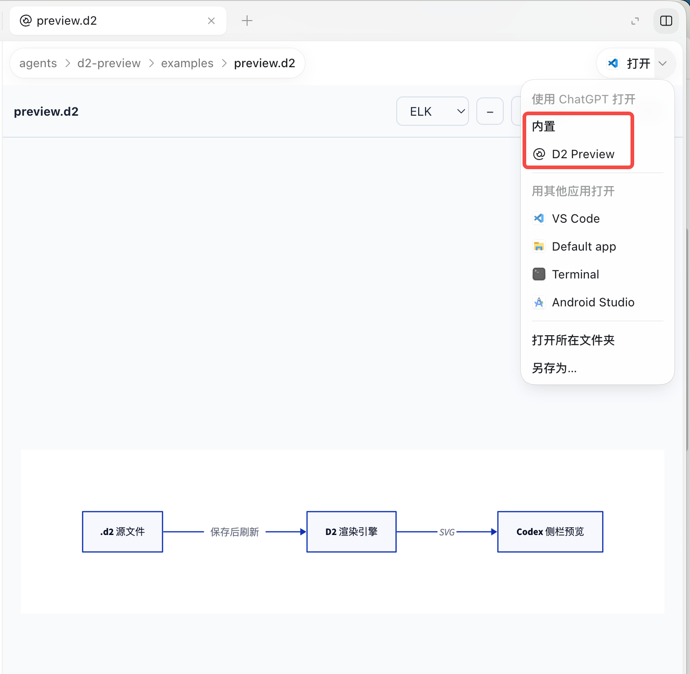

# D2 Preview for Codex

在 Codex 桌面应用的侧栏直接预览 `.d2` 图表，支持 ELK / Dagre 布局切换、鼠标滚轮缩放、适应窗口、PNG 导出和浅色 / 深色主题。

图表由本机 D2 CLI 渲染为 SVG。无需 OpenAI API Key，也不需要单独部署服务。

## 安装

需要 Node.js 22+、npm、D2 CLI，以及支持插件命令和文件预览扩展的 Codex 桌面应用 / CLI。当前已在 macOS 上验证，其他平台尚未验证。D2 验证版本为 0.7.1。

macOS 可通过 Homebrew 安装依赖：

```sh
brew install node d2
```

确认 `node --version`、`d2 --version` 和 `codex plugin --help` 能运行，再克隆项目：

```sh
git clone https://github.com/KorionCN/codex-d2lang-preview.git
cd codex-d2lang-preview
npm ci
npm run install:codex
```

安装脚本会构建插件、查找 Node / D2 的绝对路径，并在 `.local/marketplace/` 生成本机配置，然后注册本地 marketplace、安装并启用 `d2-preview@local-d2-tools`。本机路径不会写进 Git 仓库。如果同名 marketplace 已指向旧目录，安装脚本会将该注册更新到当前目录。

如果 D2 安装在自定义目录：

```sh
D2_BIN=/absolute/path/to/d2 npm run install:codex
```

**请保留克隆目录及 `.local/`。** 当前安装方式从这里启动服务。移动目录、升级 Node 或更换 D2 路径后，重新运行安装命令。首次安装或修改服务端后，重启 Codex 以加载新的启动配置。

本仓库提供源码安装流程，不应跳过安装脚本直接把仓库注册为 marketplace：原始源码中没有本机 `.mcp.json` 和构建产物。

## 使用

1. 在 Codex 会话中打开或点击 `.d2` 文件，例如 [examples/preview.d2](examples/preview.d2)。
2. 如果先显示源码，在文件的“打开方式”菜单中选择 **D2 Preview**。部分版本将插件放在 **Open in ChatGPT** 分组中。宿主会记住该扩展名的查看器偏好，之后点击 `.d2` 可直接预览。
3. 如果宿主请求访问当前文件，确认后即可加载图表。

下图展示实际预览效果，以及“打开方式”菜单中的 **D2 Preview** 入口：



| 操作 | 效果 |
| --- | --- |
| ELK / Dagre 下拉框 | 选择后自动重新渲染，不需要点刷新 |
| 鼠标滚轮向上 / 向下 | 放大 / 缩小，尽量保持鼠标指向的图上位置 |
| ＋ / − | 放大 / 缩小 |
| 适应窗口 | 恢复随窗口尺寸自动缩放 |
| 保存 `.d2` | 宿主发出文件变更通知后自动重新渲染 |
| 刷新 | 重新读取当前文件并渲染 |
| 导出 | 弹出选项，可复制 PNG 图片到剪贴板或保存到磁盘 |

ELK 与 Dagre 使用不同的布局算法；简单直线图可能看起来几乎相同。可打开 [examples/layouts.d2](examples/layouts.d2) 比较分支图。语法错误会显示报错并保留上次成功的图。

### 导出 PNG

图表渲染完成后，点击 **导出**，在弹窗中选择 **复制图片到剪贴板** 或 **保存到磁盘**。复制的是 PNG 图片，可粘贴到支持图片的应用；保存由 Codex 处理下载或保存，默认文件名与源文件一致（例如 `preview.png`）。复制需要宿主允许剪贴板写入；若权限被拒绝，会显示错误并可改用保存。保存需要宿主支持 MCP Apps 的文件下载接口；取消或拒绝保存会显示提示。

导出使用当前成功渲染的完整图表，默认按 SVG 画布的 2 倍尺寸生成，不受滚轮缩放、窗口大小和滚动位置影响。超大图会等比例缩小，限制为最多 1600 万像素、单边 8192 像素。渲染中或源文件报错时禁用导出，避免将旧图误当作最新结果。

## 更新和卸载

```sh
git pull --ff-only
npm ci
npm run install:codex
```

重新安装后重启 Codex。只改前端并且服务仍使用同一安装目录时，关闭预览标签再打开可加载新前端；插件内“刷新”不会重新加载前端代码。

卸载可在 Codex 插件管理中移除 **D2 Preview**。不再使用后，可用下面的命令移除本地 marketplace 注册，最后删除克隆目录：

```sh
codex plugin marketplace remove local-d2-tools
```

## 常见问题

- **仍显示源码：** 检查插件已启用，在打开方式菜单中选择 D2 Preview。普通 MCP 工具列表不等于文件预览入口可用。
- **启动失败：** 检查 Node / D2 是否存在，重新运行 `npm run install:codex` 并重启 Codex。不要手动把配置改成依赖终端 PATH 的 `node`。
- **图表空白：** 查看底部状态和错误信息，关闭并重新打开预览标签。插件使用 `data:` SVG，避免桌面沙箱对 `blob:` 图片的拦截。
- **保存后没更新：** 点“刷新”。自动更新依赖宿主的文件通知；被导入文件的变更不会单独触发刷新。
- **切换布局差别很小：** 两种布局可能对简单图产生相似结果，尝试分支图。

## 范围与数据处理

- 只预览根画板，不提供多画板切换或源文件编辑功能。
- 当前文件最多 1 MiB，SVG 最多 12 MiB，渲染总超时 35 秒。
- 源码通过 stdin 交给本机 D2，不改写源文件。相对导入依赖宿主提供源文件路径。
- 插件自身没有遥测或上传服务；D2 可按图表内容读取导入文件、请求远程图标。请只预览可信来源的文件。
- 这是独立的社区项目，未发布到官方插件商店。

## 开发与验证

```sh
npm ci
npm run build
npm test
# 本机完成插件安装后，额外验证 Codex 导出的真实启动配置：
npm run test:installed
# 浏览器测试页面（模拟 MCP 宿主，不等同于 Codex 实际入口）：
node test/browser-host.mjs
```

开发页面位于 `http://127.0.0.1:18942`。目录结构、协议与验收边界见 [开发说明](docs/development.md)。

参考：[OpenAI 插件打包文档](https://developers.openai.com/plugins/build/plugins)、[文件预览扩展](https://developers.openai.com/plugins/build/extensions)。

## 许可证

[MIT](LICENSE)。D2 CLI 和 npm 依赖遵循各自许可证，D2 CLI 不随本仓库分发。
